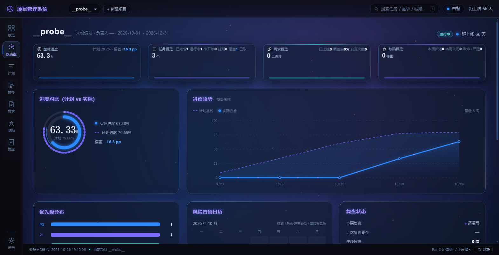
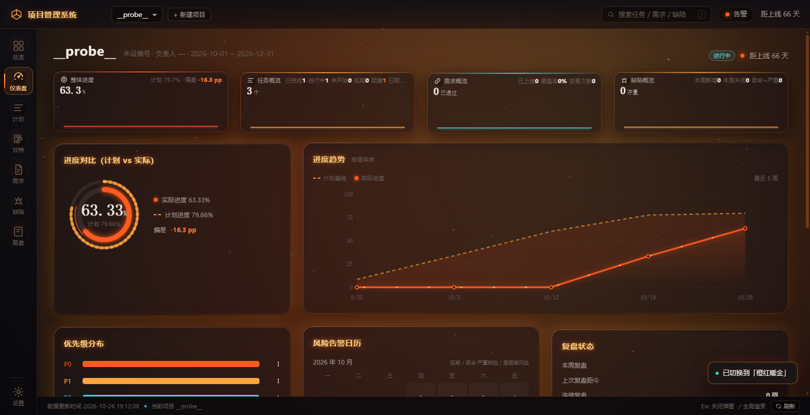
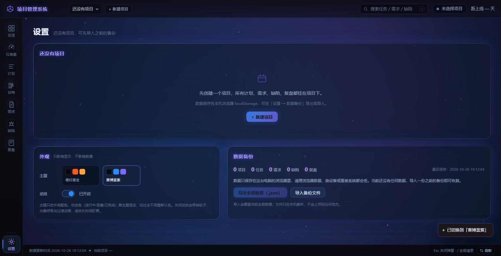

# 项目管理系统 · 作战驾驶舱

> 纯原生前端 · 零依赖 · 零构建 · 双击即开 · 数据自持

一个面向小团队与独立开发者的轻量项目管理系统。深色玻璃拟态 + 霓虹细边框的「作战驾驶舱」外观，覆盖**总览、仪表盘、计划、甘特、需求、缺陷、复盘、设置**八个模块，从立项排期到延期预警、从缺陷跟踪到周期复盘，形成一条完整闭环。

没有后端、没有账号、没有 CDN、没有一个第三方库。整个应用是 5 个文件、约 7000 行原生 HTML/CSS/JS。

---

## 预览

| 赛博蓝紫（ocean） | 橙红暖金（ember） |
|---|---|
|  |  |

外观面板（设置 → 外观）：主题色卡 + 动效开关，切换即时生效，不重建 DOM。



---

## 功能

| 模块 | 能力 |
|---|---|
| **总览** | 多项目健康度排序、项目卡片、跨项目 KPI、切换当前项目 |
| **仪表盘** | 指标卡 + 7 个面板：进度对比（计划 vs 实际双环）、进度趋势折线、优先级分布、风险告警日历、复盘状态、延期清单 Top10、风险与提醒 |
| **计划** | 任务表增删改、批量删除、必填校验、状态与进度联动、负责人与优先级 |
| **甘特** | 按周铺排、今日线、里程碑菱形、延期标识、状态配色、横轴自适应 |
| **需求** | 需求台账、编号 `REQ-xx` 稳定自增、状态流转、优先级、来源、关联任务 |
| **缺陷** | 缺陷台账、编号 `BUG-xx` 稳定自增、严重级别、关联需求、复现版本 |
| **复盘** | 周期复盘、指标自动汇总（需求流动 / 缺陷流水 / 按期率）、自我复盘总结 |
| **设置** | 项目基础信息、复盘规则、**外观（主题 + 动效）**、数据备份、危险区 |

三个全局能力贯穿全部模块：**顶栏项目切换**、**全局搜索**（`/` 快捷键，跨任务/需求/缺陷）、**健康度指示灯**与**距上线倒计时**。

---

## 快速开始

**方式一（推荐）**：直接双击 `app/index.html`。

不需要 Node、不需要 npm、不需要本地服务器。用的是普通 `<script src>` 而非 ES Module，因此在 `file://` 协议下也能正常加载。

**方式二**：交给任意静态服务器托管。

```bash
# 例如
python -m http.server 8000 --directory app
# 打开 http://localhost:8000
```

首次打开是**空列表**，没有任何假数据。先点顶栏「+ 新建项目」，或在「设置 → 数据备份」导入一份备份。

---

## 主题与动效

两套主题共用**同名 CSS 变量**，切换只改 `<html data-theme>` 一个属性，纯 CSS 生效：

| 主题 | 主色 | 次色 | 基底 |
|---|---|---|---|
| `ember` 橙红暖金（默认） | `#FF5A1F` | `#FFA53D` | `#08080C` |
| `ocean` 赛博蓝紫 | `#2E8BFF` | `#7C6BFF` | `#060A14` |

设计上有一条硬约束：**语义色跨主题恒定**（进行中=青、已完成=绿、阻塞=橙）。颜色即含义，若随主题变化，用户每换一次外观就要重新认一次状态。优先级色（P0/P1）则随主题走，因为它表达的是强度梯度而非固定含义。

动效开关关闭后，粒子、火焰光带、光晕呼吸、正弦缓动循环全部停止；系统级 `prefers-reduced-motion` 同样会被尊重。

---

## 数据存储

| 形态 | 存储位置 |
|---|---|
| 浏览器版 | `localStorage`，键名 `projsys.v1` |
| 桌面版（Electron） | exe 同级 `data/projsys-config.json` |

内存数组是唯一真源，每次写操作后整体落盘。数据兜底靠「设置 → 数据备份」：可导出为 `projsys.backup` 格式的 JSON，也可导入还原（导入走两步确认，先校验结构再覆盖）。

**清空浏览器数据会丢失全部内容**，重要项目请定期导出备份。

---

## 目录结构

```
Project_System/
├── app/                      ← 应用本体（唯一运行必需目录）
│   ├── index.html            入口，双击即开
│   ├── style.css             设计 Token / 玻璃拟态 / 两套主题 / 动效
│   └── js/
│       ├── store.js          数据层：CRUD、指标、复盘、备份
│       ├── charts.js         手写 SVG 图表（双环 / 折线 / 条形 / 日历）
│       ├── views.js          八个视图的渲染
│       └── app.js            路由、事件委托、弹窗表单、Toast、动效循环
├── build/                    ← 可选：Electron 桌面封装工程
│   ├── main.js               主进程：原子写盘、配置自愈、单实例锁
│   ├── preload.js            contextBridge 白名单接口
│   ├── pack.js               一条命令打包 + 投放
│   └── package.json          electron / electron-packager / jsdom
├── tests/                    ← 233 条 jsdom 回归断言
├── docs/
│   ├── PRD-项目管理系统.md    需求、视觉与动效规范
│   └── qa/                   四轮验收报告 + 效果截图
├── .gitignore
└── README.md
```

---

## 测试

10 个脚本、**233 条断言**，覆盖数据层、路由、状态联动、备份、外观与历史回归。

```bash
# 1) 装依赖（jsdom 仅用于测试，应用本身零依赖）
cd build && npm install && cd ..

# 2) 跑全部
cd tests
export NODE_PATH="$PWD/../build/node_modules"
for f in test s1 r1 regress2 dash-remove g8 g1mig g2keys backup appearance; do node $f.js; done
```

脚本内的应用路径是**相对解析**的（`path.resolve(__dirname, '..', 'app')`），克隆到任意目录可直接运行。

> 这套脚本是断言集而非测试框架，输出靠 `console.log` 的 PASS/FAIL 计数。动画、`backdrop-filter`、真实点击等浏览器行为不在覆盖范围内，那部分由无头 Edge + CDP 探针验证，结论见 `docs/qa/`。

---

## 桌面便携版（可选）

仓库不含打包产物，需要时自行构建：

```bash
cd build
npm install

# 打包前必须先从 app/ 同步页面资源，否则打出的 exe 没有页面
mkdir -p web && cp ../app/index.html ../app/style.css web/ && cp -r ../app/js web/js

node pack.js          # 产物投放到仓库同级 output/
```

启动时程序锚定**自身 exe 所在目录**：`data/projsys-config.json` 不存在就生成、存在就原样加载（绝不覆盖）、损坏则备份为 `.broken-<时间戳>.json` 后重建；目录不可写时自动回退到 `%APPDATA%`。写入走 `.tmp` + rename 原子落盘。

安全模型：`contextIsolation: true` + `nodeIntegration: false`，页面拿不到 Node，只能通过 preload 暴露的读写接口访问文件。

---

## 技术约束

这些约束不是风格偏好，而是为了让应用在 `file://` 下零成本运行：

- 禁用 `type="module"`（`file://` 下 CORS 会拒绝加载），改用普通 `<script src>` + 全局命名空间
- 禁用所有 CDN 与第三方库，图表用手写 SVG
- 动效只允许 `transform` 与 `opacity`，避免触发重排
- 数字格式化、日期计算均自行实现，不引 lodash / dayjs
- 表单由 schema 驱动，新增字段只改 schema 不写模板

---

## 文档

- 需求与设计规范：[`docs/PRD-项目管理系统.md`](docs/PRD-项目管理系统.md)
- 验收报告：`docs/qa/QA-REPORT-R1 ~ R4`

---

## License

MIT
